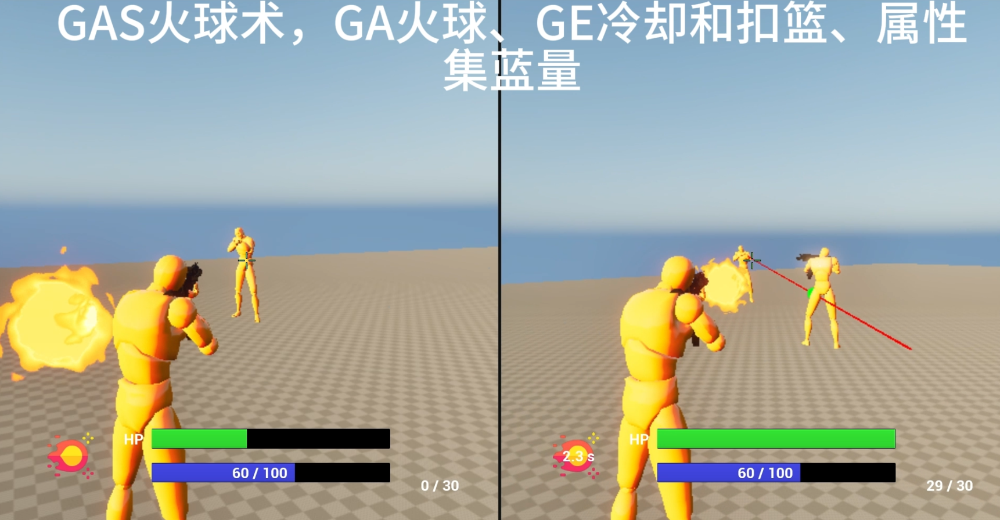

# UE5 C++ 多人闯关 Gameplay Demo

基于 **Unreal Engine 5.7 和 C++** 开发的第三人称多人 Gameplay Demo。

项目围绕双武器拾取与切换、射击与换弹、GAS 火球技能、AI 战斗、钥匙开门、三关连续闯关、局内成长和重开构建玩法流程。

重点展示 **C++ Gameplay 开发、组件化设计、数据驱动武器、GAS 基础接入、AI 行为以及服务器权威网络同步**。

核心 Gameplay 逻辑使用 C++ 实现，Blueprint 用于资源配置、GameplayEffect 配置、角色外观、动画蓝图及 UMG 界面布局与绑定。

[观看演示视频](https://www.bilibili.com/video/BV1umni6zE9r/) · [下载 Windows 版本](https://pan.baidu.com/s/178cIum6VtKv1djhs2hWzKw?pwd=1234)

> 本文说明对应当前 main 分支源码；演示视频和下载包展示的功能以各自版本为准。

## Gameplay

- 第三人称移动、跳跃、冲刺与场景探索。
- 拾取手枪与步枪，最多持有两把武器，通过 `Q` 切换。
- 按住鼠标左键持续尝试射击，实际开火频率受武器射击冷却限制。
- 射击消耗弹药，通过 `R` 换弹；换弹期间不能射击，切枪或死亡时取消换弹。
- 按 `1` 释放 GAS 火球技能，消耗蓝量并进入冷却。
- UI 显示当前蓝量、蓝量进度条及火球冷却剩余时间。
- AI 敌人执行巡逻、视觉感知、追击、近距离攻击与目标切换。
- 任意玩家拾取钥匙后，全队共享当前关卡的开门权限。
- 清空当前关卡敌人后，由服务器统一推进至下一关。
- 支持 `NewWorld → LevelTwo → LevelThree → Victory` 三关流程。
- 每通过一关提升本局枪械伤害倍率，并向玩家发送通关奖励提示。
- 玩家死亡后显示重开界面；重开时统一返回第一关并重置本局成长。

## Features

### GAS 火球技能

以火球术接入 Gameplay Ability System，串联技能授予、激活、消耗、冷却、弹体生成和 UI 展示。

| 组成 | 当前职责 |
| --- | --- |
| `UAbilitySystemComponent` | 管理角色技能、GameplayEffect 与属性访问 |
| `UGA_Fireball` | 检查施法条件、提交消耗与冷却、生成火球弹体 |
| `GE_FireballCost` | 配置火球的蓝量消耗，当前示例为每次 20 点 |
| `GE_FireballCooldown` | 配置火球冷却，当前示例为 3 秒 |
| `Cooldown.Fireball` | 标识火球冷却状态，并用于查询对应活动效果 |
| `UMyAttributeSet` | 保存、复制和限制 `Mana`、`MaxMana` |
| `AFireballProjectile` | 服务器飞行模拟、碰撞检测、伤害结算与销毁 |

技能执行流程：

1. `AMyPlayerController` 接收 `IA_Fireball` 输入。
2. 调用 `AMyCharacter::CastFireball()`。
3. 角色通过 ASC 的 `TryActivateAbilityByClass()` 请求激活技能。
4. `UGA_Fireball` 在服务器检查施法角色、存活状态与弹体配置。
5. 调用 `CommitAbility()`，检查并提交技能消耗与冷却。
6. 提交成功后，由服务器生成火球弹体。
7. 技能结束，已生成的弹体继续独立飞行和处理命中。

实现要点：

- 角色实现 `IAbilitySystemInterface`，提供统一的 ASC 访问入口。
- ASC 与 AttributeSet 创建在角色上。
- 在 `BeginPlay`、`PossessedBy` 和 `OnRep_Controller` 中初始化或刷新 Ability Actor Info。
- 技能由服务器通过 `GiveAbility()` 授予。
- 火球技能使用 `InstancedPerActor` 实例化策略与 `ServerOnly` 网络执行策略。
- 冷却未结束、蓝量不足或角色死亡时，技能不能正常完成释放。
- 蓝图负责配置火球技能使用的弹体类、消耗效果与冷却效果。

### 火球弹体与伤害

火球使用独立 Actor，分离技能激活与弹体生命周期。

- `SphereComponent` 负责碰撞检测，模型组件负责外观。
- `ProjectileMovementComponent` 负责飞行，默认速度为 `1000 cm/s`，不受重力影响。
- 发射方向使用服务器掌握的角色瞄准朝向。
- 生成时设置 `Owner` 与 `Instigator`，移动时忽略施法者。
- 服务器模拟飞行与碰撞，客户端接收 Actor 移动复制。
- 客户端关闭弹体移动组件和碰撞，避免重复模拟与伤害结算。
- 使用 `bHasHit` 防止同一颗火球重复结算命中。
- 命中后由服务器调用 `ApplyDamage()`，随后销毁弹体。
- 未命中的弹体在 3 秒后自动清理。

当前 `DamageAmount` 的 C++ 默认值为 `70`，可在弹体蓝图中调整。

火球伤害接入现有的 `UHealthComponent`。当前 GAS 负责技能激活、蓝量与冷却，生命值和受伤流程仍由原有生命组件处理。

### 蓝量与火球冷却 UI

蓝量 UI 从当前角色实际使用的 AttributeSet 读取数据。

- `Mana` 与 `MaxMana` 初始值均为 `100`。
- 使用属性复制与 `GAMEPLAYATTRIBUTE_REPNOTIFY` 同步蓝量。
- GameplayEffect 修改蓝量后，通过 `PostGameplayEffectExecute()` 将数值限制在 `0 ~ MaxMana`。
- `GetManaText()` 提供“当前蓝量 / 最大蓝量”文本。
- `GetManaPercent()` 提供 `0 ~ 1` 的进度条比例。
- `WBP_ManaWidget` 用于蓝量展示，`WBP_Fireball` 用于技能与冷却展示。

火球冷却提示读取 ASC 中对应 GameplayEffect 的实际剩余时间：

1. 获取 `Cooldown.Fireball` 标签。
2. 使用 `MakeQuery_MatchAnyOwningTags()` 构建活动效果查询。
3. 通过 `GetActiveEffectsTimeRemaining()` 获取剩余时间。
4. 如果匹配多个效果，取最长的剩余时间。
5. 冷却期间显示一位小数的秒数；冷却结束后清空倒计时文本。

UI 不单独维护一套冷却计时器，显示内容来自角色当前的活动效果。

### 数据驱动武器与双武器切换

通过 `UWeaponDataAsset` 区分武器静态配置与实例运行状态。

| 配置项 | 用途 |
| --- | --- |
| `GunName`、`GunMesh` | 武器名称与模型 |
| `Damage`、`MaxRange` | 基础伤害与射程 |
| `MagazineSize` | 弹匣容量 |
| `ShootCD` | 两次有效射击之间的最小间隔 |
| `ReloadDuration`、`ReloadMontage` | 换弹时间与动画 |
| `FireSound` | 开火声音 |
| `MuzzleFlash`、`MuzzleSocketName` | Niagara 枪口特效与挂点 |
| `VerticalRecoilStrength`、`HorizontalRecoilStrength` | 垂直与水平后坐力 |

- 提供手枪与步枪的 DataAsset 配置示例。
- `AWeaponBase` 保存弹药、上次开火时间和换弹状态。
- `UWeaponComponent` 管理当前武器、备用武器与角色挂点。
- 武器实现 `IInteractable`，接入统一交互流程。
- 服务器完成装备、设置归属并将武器附着到角色。
- 最多持有两把武器，备用武器隐藏模型。
- 切枪时服务器交换两个武器引用，客户端通过 RepNotify 更新模型显示。
- 弹药 UI 根据当前武器实例与 DataAsset 显示“剩余弹药 / 弹匣容量”。

### 连续射击与换弹

射击输入使用 Enhanced Input 的 `Triggered` 回调，按住鼠标左键可持续提交射击请求。

- 每次有效开火由服务器检查武器归属、弹药、射击冷却与换弹状态。
- 通过检查后扣除弹药、执行射线检测并结算伤害。
- 实际射速由 `ShootCD` 限制。

换弹由服务器管理状态和完成时间：

- 玩家通过 `Reload` Server RPC 请求换弹。
- 满弹匣、正在换弹或角色死亡时，不开始新的换弹。
- 服务器设置 `bReloading`，并使用 Timer 等待 `ReloadDuration`。
- `bReloading` 通过 RepNotify 驱动客户端播放或停止换弹 Montage。
- 服务器修改状态后同步执行自身的动画更新。
- Montage 播放速率根据动画长度与换弹时间计算。
- 换弹完成后，将当前弹药补满至弹匣容量。
- 切枪或死亡时，通过 `CancelReload()` 清除计时器并结束换弹表现。

当前采用计时换弹，尚未设置备用弹药库存。

### 战斗反馈

| 反馈 | 实现方式 |
| --- | --- |
| 枪声 | 服务器成功开火后，通过 NetMulticast 播放武器配置的声音 |
| 枪口特效 | 将 Niagara 特效附着到武器枪口 Socket |
| 枪械命中标记与提示音 | 服务器确认命中带生命组件的存活目标后，通过 Client RPC 通知射手 |
| 换弹动画 | 根据复制的换弹状态播放或停止 Montage |
| 简单后坐力 | 仅由本地控制的角色修改自己的视角 |
| 死亡表现 | 生命组件广播死亡事件，角色停止移动并进入 Ragdoll |

- 命中标记显示约 `0.1` 秒，连续命中时刷新隐藏计时器。
- 后坐力由垂直上抬与随机水平偏移组成。
- 枪械射线及命中点的调试绘制仅在非 Shipping 构建中启用。

### AI 与随机生成

使用 C++ `AIController`、AI Perception、NavMesh 与 Timer 实现基础敌人行为。

- 配置巡逻点时，按巡逻点移动。
- 未配置巡逻点时，使用 `GetRandomReachablePointInRadius()` 寻找可达位置。
- 通过视觉感知发现玩家并进入追击。
- 根据与目标的距离执行移动或近距离攻击。
- 使用 Timer 控制攻击冷却。
- 当前目标丢失或被判断为死亡时，尝试寻找其他可见且存活的玩家。
- 没有可用目标时恢复巡逻。
- 玩家和敌人共用 `UHealthComponent`，统一处理受伤、生命值与死亡事件。

`AAISpawner` 在指定 Box 区域内随机选择位置，通过向下射线寻找地面并生成敌人，当前每个生成器的生成数量范围为 `3 ~ 6`。

### 多人闯关与局内成长

关卡流程：

`NewWorld → LevelTwo → LevelThree → Victory`

- `GameMode` 在服务器统计当前关卡敌人数量。
- 关卡开始后延迟统计，为随机生成流程预留时间。
- 敌人死亡时通知 `GameMode` 更新剩余数量。
- 第一、第二关敌人清空后，通过 `ServerTravel` 统一切换地图。
- 过关时通过 Client RPC 向各玩家发送 Reward UI 通知。
- 第三关完成后，通过 Client RPC 向各玩家显示最终 Victory UI。

服务器使用 `UMyGameInstance` 保存跨关卡的本局枪械伤害倍率：

| 关卡 | 伤害倍率 |
| --- | ---: |
| 第一关 | 1.0 |
| 第二关 | 2.2 |
| 第三关 | 3.4 |

枪械最终伤害：

`FinalDamage = WeaponDamage × DamageMultiplier`

每次过关调用 `ApplyDamageUpdate()`，使倍率增加 `1.2`；重开时调用 `ResetRun()`，恢复为 `1.0`。

当前该倍率用于枪械射击伤害，火球使用弹体自身的 `DamageAmount`。

### 交互与界面

- 使用射线检测选择交互目标并显示提示。
- 武器、钥匙与门通过 `IInteractable` 提供统一交互入口。
- 任意玩家拾取钥匙后，服务器更新 `GameState` 中的队伍钥匙状态。
- 服务器验证开门权限，并同步门的开关状态。
- UI 包括血条、准星、交互提示、弹药、蓝量、火球冷却、命中标记、通关奖励、死亡与胜利界面。
- 使用 `IsLocallyControlled()` 和 `IsLocalController()` 区分本地输入、界面与网络副本逻辑。

## Networking

核心玩法采用 **Server Authoritative** 模型：客户端提交操作请求，服务器执行关键判定并同步结果。

| 系统 | 服务器职责 | 客户端同步与表现 |
| --- | --- | --- |
| 枪械射击 | 检查射击条件、扣弹药、射线检测与伤害结算 | 接收弹药、生命值及射击表现 |
| 武器装备与切换 | 设置归属、附着武器、交换武器引用 | RepNotify 更新碰撞与模型显示 |
| 换弹 | 管理状态、计时与弹药补充 | 根据复制状态播放 Montage |
| GAS 火球 | 授予技能、执行技能、提交消耗与冷却、生成弹体 | 接收属性、活动效果及弹体移动 |
| 生命与死亡 | 修改生命值和死亡状态 | OnRep 广播事件，更新 UI 与 Ragdoll |
| 钥匙与门 | 验证交互、更新队伍钥匙权限和门状态 | 接收共享状态与场景变化 |
| 关卡与重开 | 统计敌人、决定关卡推进、重置成长 | 随服务器切换地图，显示本地 UI |

### 射击请求检查

`ServerShoot` 与后续射击流程进行基础校验：

- 角色是否存活。
- 射击方向是否为非零向量，并进行标准化。
- 客户端提交的射击起点是否在服务器允许的角色附近范围内。
- 当前武器是否有效且属于该角色。
- 武器配置、射程与弹药是否有效。
- 射击冷却是否结束，当前是否正在换弹。

枪声与枪口特效由 NetMulticast 分发；命中标记与提示音通过 Client RPC 发送给射手；后坐力只影响开枪者自己的视角。

### GAS 与弹体复制

- ASC 开启复制，当前使用 `Full` GameplayEffect 复制模式。
- `Mana` 与 `MaxMana` 使用 AttributeSet 属性复制。
- 火球技能使用 `ServerOnly` 执行策略。
- 弹体由服务器生成、移动、判定命中并销毁。
- 客户端根据复制结果显示弹体，并从本地 ASC 查询冷却剩余时间。

### 移动与冲刺

- 玩家与敌人使用 Character Movement 及角色移动复制。
- 冲刺输入先修改本地移动速度，再通过 `ServerSprint` 请求服务器同步速度。

### 多人重开

重开按钮调用 `ServerRestart`：

1. 服务器重置本局伤害倍率。
2. 通过 `ServerTravel` 返回 `/Game/Maps/NewWorld`。
3. 所有玩家开始新一轮闯关。

## Core Architecture

| 类 | 职责 |
| --- | --- |
| `AMyCharacter` | 移动、射击与交互执行、Server RPC、ASC 接入、技能激活入口及死亡表现 |
| `AMyPlayerController` | Enhanced Input、本地 UI、弹药与蓝量查询、冷却查询、客户端反馈与重开请求 |
| `UGA_Fireball` | 技能条件检查、消耗与冷却提交、火球生成 |
| `AFireballProjectile` | 弹体飞行、服务器命中、伤害与生命周期 |
| `UMyAttributeSet` | 蓝量属性、复制与数值限制 |
| `UWeaponDataAsset` | 武器数值、模型、音效、特效与动画配置 |
| `AWeaponBase` | 武器实例状态、弹药、射击冷却、装备与换弹 |
| `UWeaponComponent` | 双武器管理、拾取入口、挂点与切换 |
| `UHealthComponent` | 受伤、生命值与死亡状态复制、事件广播 |
| `AEnemyAIController` | 巡逻、感知、追击、目标切换与攻击冷却 |
| `AEnemyCharacter` | 敌人攻击、死亡表现与死亡通知 |
| `AAISpawner` | 区域内随机敌人生成 |
| `AMyGameModeBase` | 服务器敌人统计、关卡推进与胜利判定 |
| `UMyGameInstance` | 跨关卡局内伤害倍率与 Run 重置 |
| `AMyGameStateBase` | 队伍钥匙状态复制 |
| `IInteractable` / `ADoorKey` / `ADoor` | 统一交互、钥匙拾取与门控制 |

### 主要代码入口

- [玩家角色与射击、技能入口](Source/JobDemo/Private/Character/MyCharacter.cpp)
- [玩家控制器、输入与 UI 查询](Source/JobDemo/Private/Core/MyPlayerController.cpp)
- [GAS 火球技能](Source/JobDemo/Private/GAS/GA_Fireball.cpp)
- [火球弹体](Source/JobDemo/Private/GAS/FireballProjectile.cpp)
- [蓝量属性集](Source/JobDemo/Private/GAS/MyAttributeSet.cpp)
- [GameplayTag 配置](Config/DefaultGameplayTags.ini)
- [武器静态配置](Source/JobDemo/Public/Weapons/WeaponDataAsset.h)
- [武器实例与换弹](Source/JobDemo/Private/Weapons/WeaponBase.cpp)
- [双武器组件](Source/JobDemo/Private/Weapons/WeaponComponent.cpp)
- [生命组件](Source/JobDemo/Private/Components/HealthComponent.cpp)
- [AI 控制器](Source/JobDemo/Private/AI/EnemyAIController.cpp)
- [随机敌人生成](Source/JobDemo/Private/AI/AISpawner.cpp)
- [GameMode 与关卡推进](Source/JobDemo/Private/Core/MyGameModeBase.cpp)
- [GameInstance 与局内成长](Source/JobDemo/Private/Core/MyGameInstance.cpp)

## Controls

| 输入 | 功能 |
| --- | --- |
| WASD | 移动 |
| 鼠标 | 控制视角 |
| Space | 跳跃 |
| Shift | 冲刺 |
| F | 交互：拾取武器、拾取钥匙、开关门 |
| 鼠标左键 | 射击，按住可连续射击 |
| R | 换弹 |
| Q | 切换当前武器与备用武器 |
| 1 | 释放火球技能 |

## Getting Started

### 开发环境

- Unreal Engine 5.7
- C++
- Visual Studio
- Windows

项目已启用 `GameplayAbilities` 插件，模块依赖包含 `GameplayAbilities`、`GameplayTags`、`GameplayTasks`、`EnhancedInput`、`AIModule`、`NavigationSystem`、`UMG` 与 `Niagara`。

### 运行源码

1. 克隆或下载仓库。
2. 为 `JobDemo.uproject` 生成 Visual Studio 项目文件。
3. 使用 `Development Editor / Win64` 配置编译。
4. 打开 `JobDemo.uproject`。
5. 进入 `/Game/Maps/NewWorld` 地图。
6. 点击 Play 运行。

### 编辑器多人运行

1. 在 Play 设置中将玩家数量设为 `2`。
2. 将网络模式设为 `Play As Listen Server`。
3. 使用独立游戏窗口，分别操作主机与客户端。

建议检查以下流程：

- 两把武器的拾取、切换、持续射击与弹药同步。
- 射击冷却、空弹匣限制、换弹动画及切枪取消换弹。
- 枪声与枪口特效同步，以及仅射手可见的命中反馈。
- 主机和客户端分别释放火球，观察弹体与伤害结果。
- 施法后的蓝量扣除、冷却倒计时及冷却期间的重复施法限制。
- 蓝量不足或角色死亡后的施法限制。
- 队伍钥匙共享、门状态同步与 AI 目标切换。
- 三关推进、枪械伤害成长、胜利和多人重开。

## Packaging

项目包含 Windows Development 打包配置，并显式加入三张闯关地图：

- `/Game/Maps/NewWorld`
- `/Game/Maps/LevelTwo`
- `/Game/Maps/LevelThree`

后续地图需要被 Cook 到打包版本中，供 `ServerTravel` 使用。

敌人延迟统计、奖励提示隐藏等计时逻辑使用成员函数与成员 `FTimerHandle` 管理。

## Performance

此前 Windows Development 打包版本的场景性能记录：

| 项目 | 记录 |
| --- | --- |
| CPU | Intel i5-12600KF |
| GPU | NVIDIA RTX 2080 Ti |
| 内部渲染分辨率 | 约 1400 × 788 |
| Frame | 约 4.71 ms |
| Game Thread | 约 1.44 ms |
| Draw Thread | 约 4.70 ms |
| GPU Time | 约 4.13 ms |
| Draw Calls | 约 291 |

以上为此前测试场景的性能基线，不代表加入 GAS 后最新源码的重新测量结果。

## Current Scope

当前项目用于展示多人 Gameplay 基础实现与持续迭代，主要范围如下：

- GAS 已覆盖火球技能激活、蓝量消耗、冷却、属性复制与 UI 查询。
- 生命值与伤害仍使用 `ApplyDamage + UHealthComponent`，尚未迁移为 GAS 伤害效果。
- 火球由服务器执行，尚未加入客户端预测弹体。
- 枪械射击表现等待服务器确认，尚未加入射击本地预测或延迟补偿。
- 蓝量当前没有自动恢复机制。
- 武器最多持有两把；换弹直接补满弹匣，没有备用弹药库存。
- 后坐力采用每枪修改视角的简单实现，暂未加入自动回正。
- 局内成长采用固定枪械伤害倍率 `1.0 → 2.2 → 3.4`，火球暂不参与该倍率。
- 暂未加入随机 Buff 选择、复杂 Build 组合或永久成长系统。

## Screenshot

